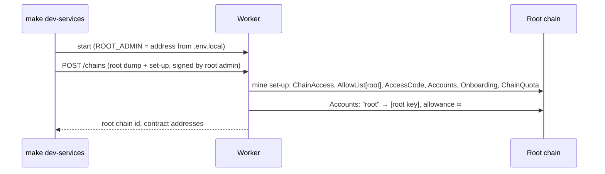
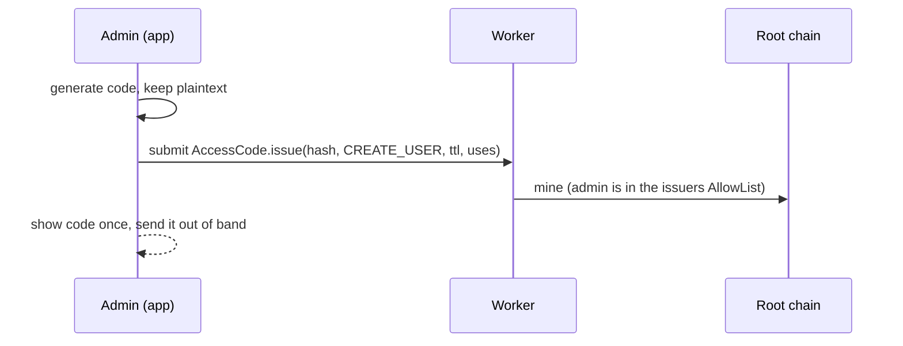
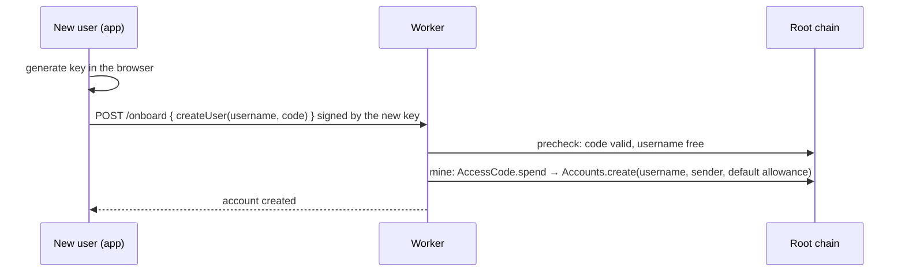
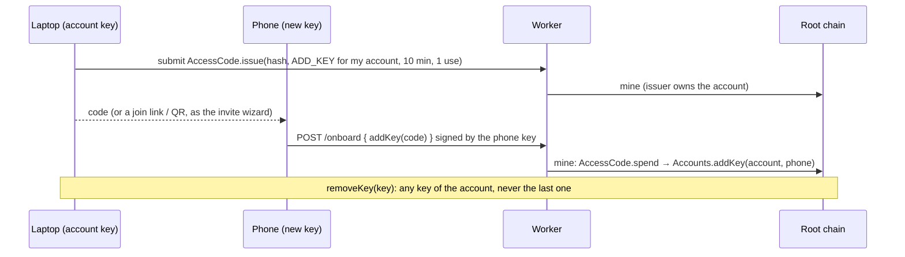

# Accounts, codes and self-service chains — draft design

Board: t-151 (Chain workspace), step a. **Draft, parked** (Aaron, 2026-11-25): data model, flows and scenarios; resume after the
SpacetimeDB spike (t-155).

## Intent

Only the root chain is special: the Makefile creates it with a chosen admin. Everything else is self-service through
small, reusable contracts: people redeem short-lived codes to register keys against an account (like OAuth 2.1 code
exchange), add and remove their own keys, and create chains within an allowance. Two access layers stay separate
(ADR-0025): the **chain ACL** (read, write, deploy on the submitting key) and **contract ACLs** (allow-lists the
contracts check).

## Contracts

Reusable (deployed on the root chain and on any chain):

- **AllowList** — a set of addresses, with an admin (an address, or another AllowList: governance of governance).
- **AccessCode** — pending codes: `keccak256(code) → { purpose, account, expiry, usesLeft, issuer }`. Who may issue a
  purpose is decided by an AllowList (for `CREATE_USER`) or by account ownership (for `ADD_KEY`, only for your own
  account). Today's invites inside `ChainAccess` are the same idea; this pulls it out.

Root only:

- **Accounts** — `username → account { keys[], chainAllowance, chainsCreated }`, and `key → account`.
- **Onboarding** (orchestration) — `createUser(username, code)`, `addKey(code)`, `removeKey(key)`.
- **ChainQuota** (orchestration) — `reserveChain()`: spends one of the caller's account allowance and returns a
  ticket the worker redeems to create the chain (the same shape as today's deploy-code claim).

```mermaid
erDiagram
    ALLOWLIST ||--o{ MEMBER : holds
    ALLOWLIST |o--o| ALLOWLIST : "governed by"
    ACCESSCODE }o--|| ALLOWLIST : "CREATE_USER issuers"
    ACCESSCODE ||--o{ CODE : stores
    CODE }o--o| ACCOUNT : "ADD_KEY for"
    ACCOUNTS ||--o{ ACCOUNT : stores
    ACCOUNT ||--|{ KEY : has
    ACCOUNT ||--o{ TICKET : reserves
    TICKET ||--o| CHAIN : "redeemed for"
    CHAIN ||--|| CHAINACCESS : "has (chain ACL)"
    CHAINACCESS ||--o{ ROLE : "read / write / deploy"
    ROLE }o--|| KEY : "granted to"

    MEMBER { address addr }
    CODE { bytes32 hash; uint8 purpose; uint64 expiry; uint32 usesLeft; address issuer }
    ACCOUNT { string username; uint32 chainAllowance; uint32 chainsCreated }
    KEY { address addr; bytes pubkey }
    TICKET { uint256 id; address by; bool redeemed }
    CHAIN { string id; address admin }
```

## Scenarios

### 1. Bootstrap (`make dev-services` / `make deploy`)

The worker creates the root chain as today; its set-up deploys `ChainAccess`, `AllowList` (code issuers = [root
admin]), `AccessCode`, `Accounts`, `Onboarding`, `ChainQuota`, and creates account `root` with the admin key and an
unlimited allowance.



### 2. The admin sets themselves up

The admin imports the root key into the app once, then adds their other devices with their own `ADD_KEY` codes
(scenario 4) and creates chains freely (scenario 5). They onboard others by issuing `CREATE_USER` codes:



### 3. A new user is onboarded

The new key is not a root writer, so the worker accepts exactly one prechecked `createUser` call from any signed key
(the join pattern): the code is valid and unspent, the username free and well-formed. Root reads are closed and the
cloud orders txs, so nobody can see the plaintext code and use it first.



### 4. A user adds (or removes) a key



### 5. A user creates and deploys a chain

```mermaid
sequenceDiagram
    participant U as User (app)
    participant W as Worker
    participant R as Root chain
    participant C as New chain
    U->>W: POST /chains { dump, setup, reserve: ChainQuota.reserveChain() } signed by an account key
    W->>R: precheck allowance; mine reserveChain → ticket, chainsCreated + 1
    W->>C: create chain, signer = admin; mine set-up
    W-->>U: chain id; the browser copy becomes a follower
```

### 6. The admin changes someone's allowance

An `AllowList` of allowance admins (root at first) may call `Accounts.setAllowance(username, n)`.

## Open questions

1. **Reading your own account.** Root reads are closed. Either the worker serves `GET /accounts/me` (signed), or
   every account key becomes a root reader (then everyone sees every account).
2. ~~Chain access by account.~~ **Decided (Aaron, 2026-11-25): chains grant accounts**; the worker resolves an
   account's keys via the root chain, so a newly added key gets every chain the account has at once. Chain access
   then depends on root being reachable (the worker checks it). Rejected: chains hold keys and the app adds each new
   key to every chain (one tx per chain, by each chain's admin).
3. **Usernames.** Rules (charset, length, case), and whether they can change.
4. **Losing every key.** Recovery by the admin (an `ADD_KEY` code for someone else's account, gated by an AllowList)?
5. **Default allowance** for a new user, and whether codes can carry their own.
6. **Contract metadata registry** (name, description, avatar, address) — this step or the Studio step.
7. **Migration.** Today's root-admin deploy codes and `ChainAccess` invites: replaced, or kept alongside.
